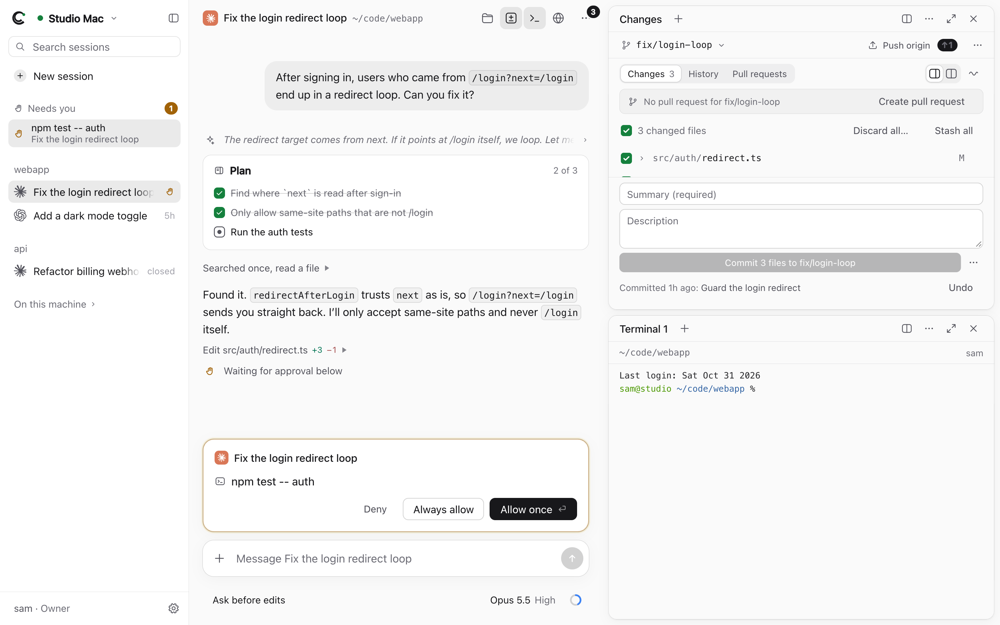
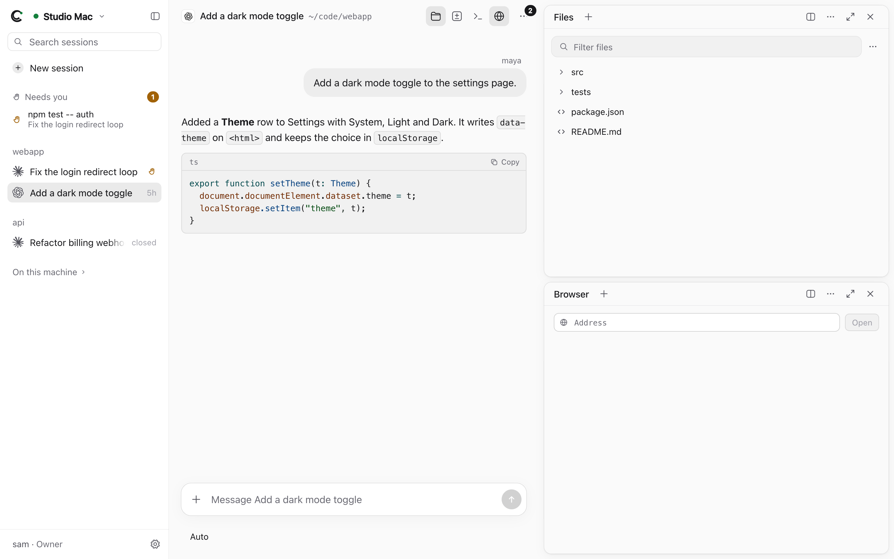
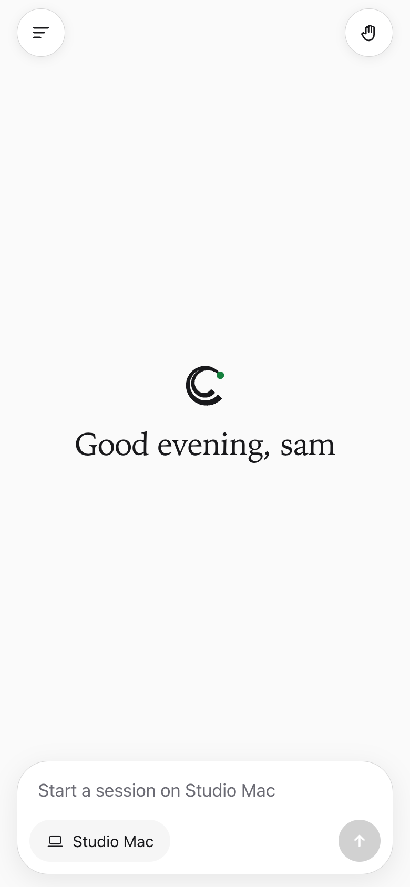
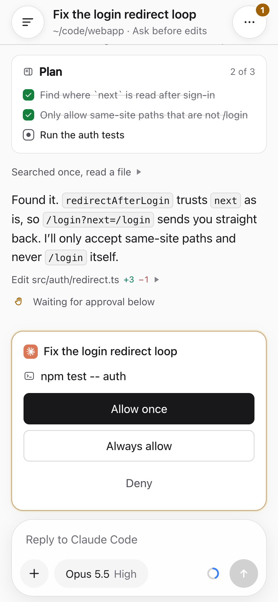
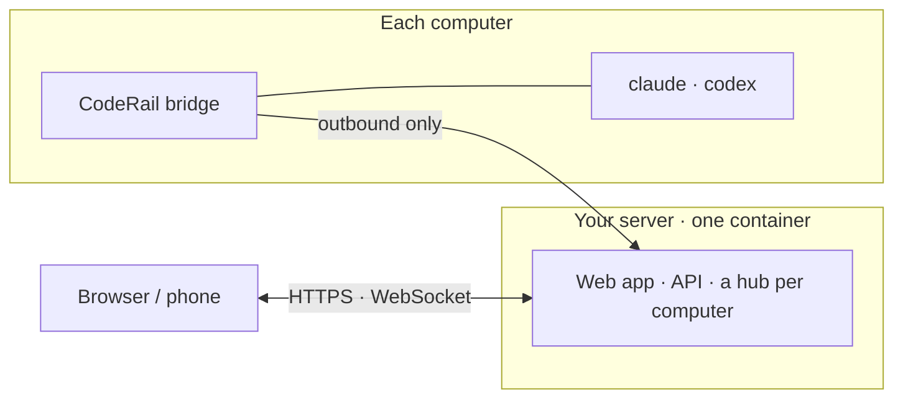

<p align="center">
  <picture>
    <source media="(prefers-color-scheme: dark)" srcset="design/brand/coderail-mark-dark.svg">
    
  </picture>
</p>

<h1 align="center">CodeRail</h1>

<p align="center">
  <b>Your coding agents, on every computer, from anywhere.</b><br>
  <sub>Self-hosted remote control for Claude Code and Codex: chats, approvals, terminals, files, git and a browser.</sub>
</p>

<p align="center">
  <a href="https://docs.coderail.codes"></a>
  <a href="https://github.com/wiva-hq/CodeRail/pkgs/container/coderail"></a>
  
  
  <a href="LICENSE"></a>
</p>

<p align="center">
  <picture>
    <source media="(prefers-color-scheme: dark)" srcset="docs/images/machine-dark.png">
    
  </picture>
</p>

<p align="center">
  <a href="https://docs.coderail.codes/getting-started/quickstart"><b>Quickstart</b></a> &nbsp;·&nbsp;
  <a href="https://docs.coderail.codes/self-hosting/deploy">Self-hosting</a> &nbsp;·&nbsp;
  <a href="https://docs.coderail.codes/getting-started/how-it-works">How it works</a> &nbsp;·&nbsp;
  <a href="https://github.com/wiva-hq/CodeRail/issues/new/choose">Report an issue</a>
</p>

---

## Why CodeRail

<table>
  <tr>
    <td width="33%" valign="top"><b>🏠 You host it</b><br><sub>One Docker container on your own server and domain. No CodeRail account, nobody in the middle.</sub></td>
    <td width="33%" valign="top"><b>🔑 Your agents stay yours</b><br><sub>Each computer runs its own <code>claude</code> and <code>codex</code> with its own login. CodeRail never holds AI keys.</sub></td>
    <td width="33%" valign="top"><b>👥 Built for teams</b><br><sub>Owner, Operator or Viewer per computer, down to folders and agents. Every change is audited.</sub></td>
  </tr>
  <tr>
    <td valign="top"><b>💬 Agent chats</b><br><sub>Claude Code and Codex over ACP: plans, tool calls, models, modes, background tasks.</sub></td>
    <td valign="top"><b>✅ Approvals anywhere</b><br><sub>Allow or deny from the browser, or from a push notification on your phone.</sub></td>
    <td valign="top"><b>🖥️ Terminals, files, git</b><br><sub>Real shells that outlive the tab; view, edit, upload and download any file; git like GitHub Desktop, pull requests included.</sub></td>
  </tr>
  <tr>
    <td valign="top"><b>🌐 A browser per chat</b><br><sub>On the computer itself, shared live with everyone in the chat, and driven by the agent too.</sub></td>
    <td valign="top"><b>📱 Made for phones</b><br><sub>An installable web app with a phone layout.</sub></td>
    <td valign="top"><b>♾️ Nothing stops</b><br><sub>Sessions keep running with every browser closed; the history stays readable offline.</sub></td>
  </tr>
</table>

<table>
  <tr>
    <td width="66%"></td>
    <td width="17%"></td>
    <td width="17%"></td>
  </tr>
</table>

## How it works



The **bridge** on each computer connects out to your server (no open ports, no VPN), runs the agents through their
ACP adapters, and serves terminals, files, git and the browser. The **server** checks every request against the
person's role and keeps the history.

## Get started

**1 · Run the server** on any machine with Docker, then put HTTPS in front of port 8080
([details](https://docs.coderail.codes/self-hosting/deploy)):

```sh
git clone https://github.com/wiva-hq/CodeRail && cd CodeRail
cp .env.example .env            # set SETUP_TOKEN
docker compose up -d            # the image from ghcr.io; everything it keeps is in ./data
```

The image is [`ghcr.io/wiva-hq/coderail`](https://github.com/wiva-hq/CodeRail/pkgs/container/coderail)
(amd64 and arm64). Update with `git pull && docker compose pull && docker compose up -d`.

**2 · Create the first admin** at `https://your-site/setup` with that token.

**3 · Add a computer.** On a Mac: **Machines → Download for Mac** and approve the code. On Linux:

```sh
curl -fsSL https://your-site/install.sh | sh
```

Every build is also on [Releases](https://github.com/wiva-hq/CodeRail/releases), with its checksums.
Everything else (roles, the browser, phones, troubleshooting) is in the **[documentation](https://docs.coderail.codes)**.

## Security, in short

Self-hosted, outbound-only computers, no AI credentials, invite-only accounts, permissions checked on the server and
again on the computer, signed and notarized Mac builds. Not end-to-end encrypted: your server keeps the history.
Read the [security model](https://docs.coderail.codes/reference/security); report vulnerabilities privately per
[SECURITY.md](SECURITY.md).

## Development

```sh
bun install
bun run dev:server     # server on :8787, data in ./data
bun run dev:web        # the web app on :5173, /api proxied to :8787
cd bridge && bun src/main.ts link http://localhost:8787 --no-service
```

| | |
|---|---|
| [`server/`](server) | Bun + SQLite: accounts, permissions, the web app and a hub per computer |
| [`bridge/`](bridge) | The program on each computer (one Bun binary): agents, terminals, files, git, browser |
| [`web/`](web) | The web app (Svelte 5), also installable on phones |
| [`mac/`](mac) | The menu bar app that carries the bridge |
| [`protocol/`](protocol) | The wire format they share |
| [`docs/`](docs) | [Design](docs/DESIGN.md), [API](docs/api.md), [Windows handoff](docs/windows.md) |

Bug reports and ideas are welcome as [issues](https://github.com/wiva-hq/CodeRail/issues/new/choose); this
repository doesn't take pull requests ([CONTRIBUTING.md](CONTRIBUTING.md)).

---

<p align="center"><sub>
  <a href="LICENSE">Apache License 2.0</a> · made by <a href="https://wiva.io"> <b>Wiva, Inc.</b></a> · see <a href="NOTICE">NOTICE</a> · the CodeRail name and logo aren't licensed for modified versions
</sub></p>
